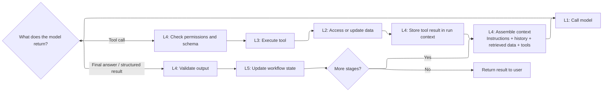

We focus on read access for now.

How does an AI system work?
An AI system can be broken down into 5 layers:
| # | Layer | Description | Example of tools |
| :--- | :--- | :--- | :--- | 
| 1 | Model | The intelligence engine: the LLM, the reasoning layer | OpenAI's GPT-6.1 Sol, Anthropic's Claude Opus 5.5, Mistral's Large 4, DeepSeek V4.1 Flash, Alibaba's Qwen 3.8 |
| 2 | Context and knowledge | What the model knows about the current task: conversation history, memory, RAG, databases, search indexes, files and retrieved information | PostegreSQL, code base, OpenClaw, NanoClaw |
| 3 | Tools and integrations | What the model can access and do: APIs, function calls, MCP servers, Gmail, calendars, code execution, browsers and external services |
| 4 | Agent runtime / harness | The execution and control environment (how an agent executes): Instructions, context assembly, tool execution, agent loop, permissions, sandboxing, validation, retries and state management | OpenClaw, NanoClaw, OpenCode |
| 5 | Orchestration layer | How work is coordinated (or how a task or workflow is coordinated): Task decomposition, planning, delegation, parallel execution, multi-agent coordination and workflow management | OpenClaw, NanoClaw, OpenCode |

Let's look at the example of a user request using different AI systems:
| Layer | 1. ChatGPT + Gmail connector | 2. OpenClaw + ChatGPT + Gmail connector | 3. OpenClaw + Mistral + Rosalind + AWS S3 |
| :--- | :--- | :--- | :--- |
| 1. Model | OpenAI's GPT-6.1, ran in OpenAI's datacenter | OpenAI's GPT-6.1, ran in OpenAI's datacenter via OpenAI API | Mistral's Large 4, ran wherever we want |
| 2. Context and knowledge | Google Gmail database for email storage and search + ChatGPT user context | Google Gmail database for email storage and search + ChatGPT user context + OpenClaw memory | S3 database for email storage + Rosalind for search + OpenClaw memory + context provided to the model |
| 3. Tools and integrations | ChatGPT-Gmail connector (via Google Gmail MCP) | OpenClaw-Gmail connector (via Google Gmail MCP) | OpenClaw-Rosalind connector (via Rosalind MCP) |
| 4. Agent runtime | ChatGPT | OpenClaw | OpenClaw |
| 5. Ochestrator | ChatGPT | OpenClaw | OpenClaw |

Step 0
User prompt: "Find all emails from my bank concerning mortgage payments over the last six months, calculate the total paid, and produce a spreadsheet."

Step 1
Planning
Objective: Understand the request and establish an execution plan.
Layers participation: 
- Orchestration (5): create a task plan
- Agent (4): loads system instructions, relevant user context and conversation history, available tool definitions, permission constraints, any relevant skills
- Model (1) interprets the user request and helps develop the plan
- Context (2): relevant context, such as user's known bank, if available, email account being searched, requested time period, previously established preferences.
Input: user prompt
Output: task plan
TASK: Mortgage payment analysis
1. Identify bank
2. Identify relevant sender addresses
3. Search emails over the target period
4. Retrieve complete email contents
5. Classify relevant emails
6. Extract payment information
7. Reconcile and deduplicate payments
8. Calculate total paid
9. Generate spreadsheet
10. Validate and deliver result

Step 2
Bank identification (plan step 1 and 2)
Objective: Establish which sender addresses belong to the bank.
Layers participation: 
- Model (1): determines how to identify the bank. If it already knows the bank from conversation history, it can use that information. Otherwise, it might request an initial search for emails containing banking-related terms or search the account's contacts.
- Agent (4): calls the tools as per model's instructions
- Tools (3): executes a Gmail search operation, for example: 
```
gmail.search_messages(
    query="mortgage OR loan OR bank statement"
)
```
- Knowledge (2): email search engine accesses the mailbox and returns candidate messages.
- Model (1): examines the sender addresses, domains and content to identify the bank and its relevant notification addresses.
- Agent (4): stores the result and updates the execution context.
Input: plan step 1 and 2
Output: bank sender addresses
```
{
  "bank": "Example Bank",
  "senders": [
    "mortgages@bank.example",
    "notifications@bank.example"
  ]
}
```

Step 3:
Email retrieval (plan 3 and 4)
Objective: Retrieve all candidate emails from the bank within the relevant period.
Layers participation:
- Model (1) determine tool to call, agent (2) calls the tool as per model's instuctions, tool (3) execute the search. The agent might execute several searches and perform several operations: executes the search calls, handles pagination, collects returned message identifiers, retrieves full message contents, downloads relevant attachments, checks that the results satisfy the permission constraints.
```
gmail.search_messages(
    sender="mortgages@bank.example",
    after="2026-05-01",
    before="2026-11-04"
)
```
- Knowledge (2) returns the relevant data consists of the email contents, sender and recipient metadata, email dates, thread relationships, attachments, potentially an email search index.
Input: plan steps 3 and 4, and step 2 output
Output: candidate emails
```
{
  "message_id": "msg_001",
  "thread_id": "thread_123",
  "sender": "mortgages@bank.example",
  "subject": "Your mortgage payment",
  "received_at": "2026-06-05T09:30:00",
  "body": "Your monthly mortgage payment of EUR 850..."
}
```

Step 4
Classification (plan 5)
Objective: Determine which candidate emails actually concern mortgage payments.
Layers participation:
- Model (1) reads the retrieved emails and classifies them.
- Agent (4) validates the structured output against an expected schema. For example: classification must be an accepted category, relevant must be a boolean, confidence must be between zero and one.
- Orchestration (5) tracks the number of relevant, irrelevant and ambiguous emails. It can also decide whether another search is necessary if the initial results appear incomplete.
Input: plan step 5, and step 4 output
Output: emails with mortgage payment information
```
{
  "message_id": "msg_001",
  "classification": "payment_confirmation",
  "relevant": true,
  "confidence": 0.98
}
```

Step 5
Payment data extraction (plan 6)
Objective: Extract structured financial information from relevant messages.
Layers participation:
- Model (1) extracts fields for each relevant email, such as:
Field                       Description
email_id	                Original email identifier
email_date	                Date the email was received
payment_date	            Date the payment was made or scheduled
amount	                    Payment amount
currency	                Payment currency
payment_status	            Paid, scheduled, due, reversed or unclear
payment_type	            Mortgage instalment, partial repayment, fees, etc.
transaction_reference       Bank transaction reference, if available
loan_reference	            Mortgage account identifier
evidence	                Relevant passage supporting the extraction
- Agent (4) manages the extraction loop.
- Tools (3) may be used for PDF text extraction, document parsing, date and currency parsing, structured output validation.
Input: plan step 6, and step 4 output
Output: structured financial information
```
{
  "email_id": "msg_001",
  "email_date": "2026-06-05",
  "payment_date": "2026-06-05",
  "amount": "850.00",
  "currency": "EUR",
  "payment_status": "paid",
  "payment_type": "monthly_instalment",
  "transaction_reference": "TRX-12345",
  "evidence": "Your payment of EUR 850 has been debited."
}
```

Step 5
Reconciliation and deduplication (plan 7)
Objective: Ensure that each payment is counted exactly once.
Layers participation:
- Model (1) interpret whether the emails concern the same transaction. It can compare: payment dates, amounts, transaction references, mortgage references, email contents, thread relationships. 
- Agent (4) can call tools (3) to execute deterministic deduplication and reconciliation logic.
```
def same_payment(a, b):
    if a.transaction_reference and b.transaction_reference:
        return a.transaction_reference == b.transaction_reference

    return (
        a.payment_date == b.payment_date
        and a.amount == b.amount
        and a.currency == b.currency
        and a.loan_reference == b.loan_reference
    )
```
Input: plan step 7, and step 5 output
Output: list of payment for the sum

Step 6
Calculate the total (plan 8)
Objective: Calculate the total amount actually paid.
Layers participation:
- Agent (4) calls tools (3) performs the actual arithmetic with a calculation tool (for example, Python), model (1) interprets the results and determines whether any exceptions need to be reported. 
Input: plan step 8, and step 5 output
Output: Sum total

Step 7
Spreadsheet generation and validation (plan 9)
Objective: Produce the requested Excel workbook.
Layers participation:
- Model (1) determines the appropriate presentation and summarises the findings, agent (4) calls tools (3) to use a spreadsheet generation tool to create the workbook. This could use: Python with openpyxl or xlsxwriter, Google Sheets API, or another spreadsheet integration. The spreadsheet may include tabs summary (overall results, total paid, number of payments, date range, currency and methodology), payments (one row per distinct payment, with date, amount, status, transaction reference and source email), source emails (relevant emails, their classifications and inclusion or exclusion reasons) and exceptions (unconfirmed payments, possible duplicates, missing information, reversals and inconsistencies).
- Orchestration (5) verifies that all required stages are complete, and returns the workbook to the user along with a summary.
Input: plan steps 9 and 10, and step 6 output
Output: spreadsheet returned to the user



Now let's assume one of the emails with the bank include all of the mortgage documentation, including mortgage payments schedule and mortgage insurance information. The mortgage insurance documents may include some health information, say about the user having a cancer, for the sake of the example. The user may want to prevent his health information to be shared with some third parties, the safest way would be to add an authorization layer in layer 2 or 3. 