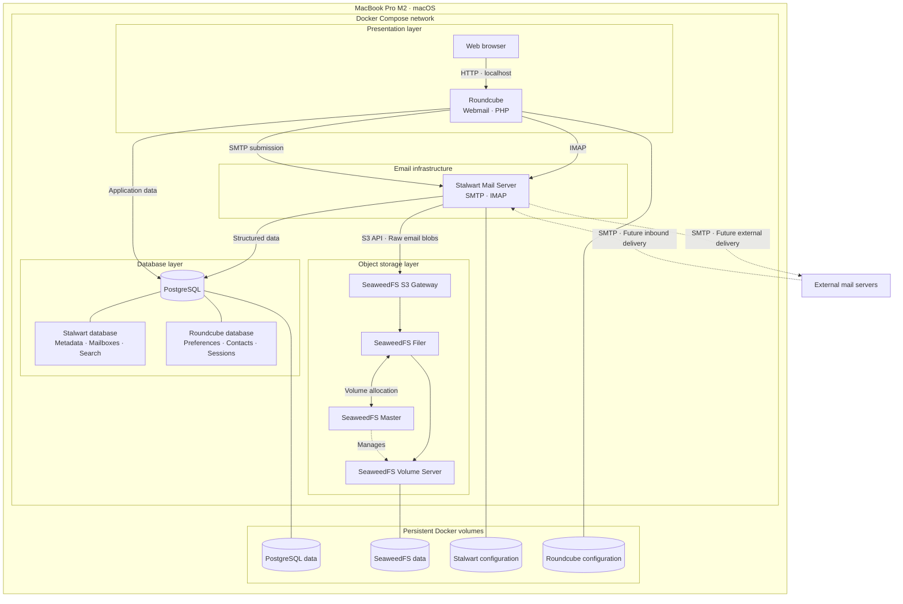

# Local Email Server Architecture — Version 1

**Environment:** MacBook Pro M2 · macOS · Docker Compose  
**Status:** Agreed baseline architecture

## Architecture diagram

## Component responsibilities

| Component | Responsibility |
|---|---|
| Roundcube | Browser-based email interface |
| Stalwart | Email server, IMAP, SMTP and mailbox management |
| PostgreSQL | Structured email metadata, search and Roundcube application data |
| SeaweedFS | Raw MIME messages and attachments through its S3-compatible API |
| Docker Compose | Container orchestration and internal networking |

## Storage organisation

| Storage | Contents |
|---|---|
| PostgreSQL — `stalwart` | Mailbox metadata, accounts and indexes |
| PostgreSQL — `roundcube` | Preferences, contacts and sessions |
| SeaweedFS — `stalwart-mail` | Original email messages and attachments |
| Docker volumes | Persistent configuration and application data |

## Deployment boundaries

For the first implementation:

- Everything runs locally in Docker Compose.
- Roundcube is accessible through `http://localhost`.
- Stalwart exposes IMAP and SMTP internally to Roundcube.
- PostgreSQL and SeaweedFS are not exposed publicly.
- External email delivery and reception are postponed until the local environment has been tested.

## Architectural principles

- **Stalwart owns email management:** it handles mailboxes, protocols and message operations.
- **PostgreSQL owns structured persistence:** it stores structured data and search information for Stalwart, plus Roundcube's application data in a separate database.
- **SeaweedFS owns binary object storage:** Stalwart stores raw email blobs, including MIME content and attachments, through the S3-compatible interface.
- **Roundcube is replaceable presentation software:** it accesses mail through IMAP/SMTP and does not own the authoritative mailbox contents.

This architecture is the baseline for the local email-server implementation. It is a single-machine development setup, not a highly available production deployment. PostgreSQL and SeaweedFS must both be included in backup and restore testing because message metadata and message blobs are stored separately.
