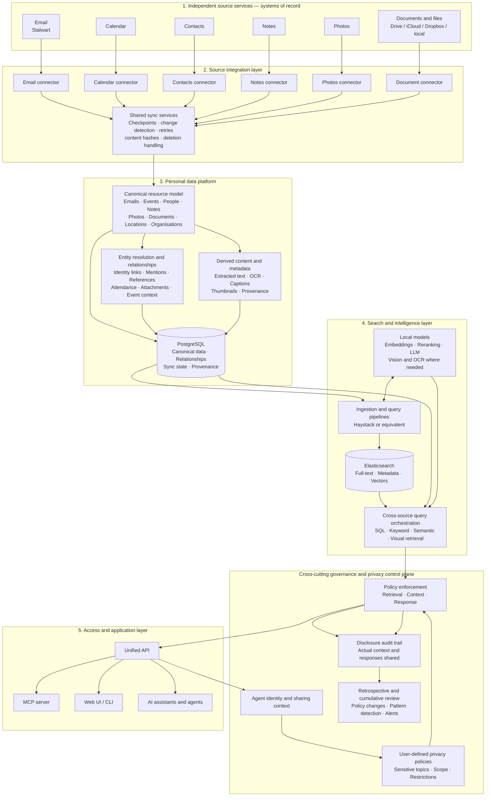

# Rosalind — Personal Data Platform

## Vision and target architecture

**Status:** Project vision and architectural direction  
**Deployment ambition:** Local-first, self-hosted, initially on an Apple Silicon Mac  
**Primary principle:** Each source application remains the owner of its data; Rosalind makes that data consistently accessible, searchable and useful across services.

---

## 1. The vision

Rosalind is a local-first personal data platform that connects independently managed personal information services and makes their data accessible through one unified interface.

The goal is not to replace email, calendar, contacts, notes, photo or file-management applications. Each service continues to own and manage its own data, using its own storage model and application-specific features.

Rosalind connects to those services, reads and synchronises their data, creates a consistent representation of the information, resolves relationships between resources, and exposes the resulting personal information through search, APIs and AI assistants.

A person should be able to ask a question that spans several applications and receive an answer grounded in the underlying records. For example:

- Find the email where a colleague suggested a restaurant, identify the related trip in my calendar, and show the photos taken there.
- Summarise everything I have about a project across email conversations, notes, meetings and documents.
- Find the latest version of a document discussed in an email and identify the people involved.
- Show the meetings I had with a particular person, the notes associated with those meetings and the documents exchanged afterwards.
- Find photographs from a particular event using its date, location, attendees or related correspondence.

This is broader than an email RAG application. It is a **personal data integration and retrieval platform**, with RAG as one of several ways to access and use the data.

## 2. Architectural principles

### 2.1 Source applications remain authoritative

Every connected application remains the system of record for the data it owns. Rosalind is a read-only consumer of those systems.

For example:

- Stalwart remains authoritative for email and mailbox state.
- The calendar service remains authoritative for events and invitations.
- The contacts service remains authoritative for address-book records.
- The notes service remains authoritative for notes and their organisation.
- The photo service remains authoritative for original photographs, albums and photo-library state.
- The document service remains authoritative for original files, folders, sharing and file versions.

Rosalind stores derived and synchronised representations to support integration and retrieval. It must not silently become a second system of record.

### 2.2 Independent services, common access

Sources can use different APIs, protocols, data models and storage technologies. The platform should hide those differences behind source-specific connectors and a common internal resource model.

A new source should be addable without redesigning the entire platform or changing existing connectors.

### 2.3 Preserve provenance

Every synchronised resource and every derived representation must remain traceable to its original source. Search results and AI answers should identify the source application and link or reference the original record whenever possible.

### 2.4 Separate integration from intelligence

Data synchronisation, normalisation and relationship management must work independently of any LLM or RAG framework. Search, RAG, agents, dashboards and other applications should consume the same platform capabilities.

### 2.5 Local-first and privacy by design

The target is to run the platform locally, initially on an Apple Silicon Mac. Source data, derived content, indexes, embeddings and inference should remain on the machine unless an explicitly configured integration requires otherwise.

Cloud APIs should not be used for embeddings, document processing or LLM inference by default. The system should make any external data transfer explicit.

### 2.6 Read-only source access

Connectors should use source credentials and permissions limited to reading and synchronising data. They must not send messages, modify events, edit notes, change contacts, delete files or alter photo libraries.

Read-only access should be enforced by the source service's permissions where possible, not merely by application convention.

### 2.7 Agent-scoped privacy and information filtering

The owner must be able to decide which parts of their personal information may be made available to each connected agent or client. These controls must apply across all connected sources, not just within an individual application or search index.

A user should be able to express a policy in terms of a sensitive topic, person, source, purpose or agent. For example: **"Agent A must not learn that I have cancer."** Rosalind should interpret this as a restriction on relevant information across emails, contacts, calendar events, notes, documents, photographs and any other connected source—not merely as a rule that hides records containing the word "cancer".

Filtering must consider both direct disclosure and information that could reasonably contribute to a sensitive inference. A doctor's email, a medical document, a photograph from treatment, a family message, or a sequence of apparently unrelated absences and personal messages may each reveal or help infer the same sensitive fact.

The policy boundary must therefore cover retrieval, context construction and the response returned to the agent. Removing an explicitly sensitive document from search results is not sufficient if other records can reconstruct the same information. Policies should be understandable, reviewable and specific to the agent or sharing context to which they apply.

### 2.8 Disclosure auditing and retrospective review

Rosalind must maintain an audit record of information actually disclosed to each agent, not just the records that were searched or considered. The audit should make it possible to establish who received what information, when, in response to which request, and under which privacy policy.

Auditing is necessary because perfect filtering cannot be assumed. A single disclosure may violate a policy, and several individually innocuous disclosures may collectively reveal something sensitive. The platform should therefore support both event-level auditing and review of disclosure patterns over time.

When a user creates or tightens a policy, Rosalind should be able to examine relevant prior disclosures and alert the user to potential conflicts. For example, a newly created health-related restriction could reveal that a medical document had already been shared with an agent the previous day. Ongoing review should also look for cumulative patterns—for example, repeated work absences, family check-ins and a message about hair loss—that may together expose a sensitive health situation.

Audit records and alerts are themselves sensitive personal data. They must be protected, access-controlled and retained according to an explicit policy. Pattern detection should be presented as a risk signal for user review, not as a guarantee that every possible inference or breach can be detected.

---

## 3. Connected source services

The platform should support distinct services, each with its own storage and lifecycle.

| Domain | Example service | Typical data | Important characteristics |
|---|---|---|---|
| Email | Stalwart; potentially other mail providers | Messages, threads, mailboxes, headers, attachments | Conversation structure, MIME content, sender/recipient identities, timestamps |
| Calendar | CalDAV-compatible or provider calendar service | Events, calendars, attendees, recurrence, locations | Strong temporal structure, time zones, recurring events and participant relationships |
| Contacts | CardDAV-compatible or provider address book | People, organisations, email addresses, phone numbers, postal addresses, notes | Multiple identifiers for the same person; duplicate and identity resolution concerns |
| Notes | Apple Notes-, Google Keep- or similar service | Notes, rich text, checklists, tags, folders, embedded media | Hierarchical or semi-structured text, links and attachments |
| Photos | Apple Photos-, Google Photos- or similar service | Original images, albums, timestamps, locations, metadata | Large binary objects, EXIF metadata, visual content and multimodal search |
| Documents and files | Google Drive, iCloud Drive, Dropbox or local files | Documents, spreadsheets, PDFs, presentations, folders and versions | File hierarchy, revisions, sharing permissions, content extraction and duplicate files |

The list is intentionally extensible. Other sources—tasks, bookmarks, messages, health records or personal finance data, for example—could be added later, subject to privacy, local-access and integration requirements.

### 3.1 Contacts are a first-class source

Contacts should not be treated only as metadata embedded in emails or calendar events. A contacts service is an independent source of address-book records and should have its own connector and synchronisation state.

The platform should preserve the original contact record while also maintaining a canonical person entity. A person may have several email addresses, phone numbers, names, organisations and source-specific IDs.

Identity resolution should be conservative. Rosalind may propose that two records refer to the same person, but it should preserve the original records and the evidence or confidence behind any match. Ambiguous matches must not be silently merged.

### 3.2 Documents and files are a first-class source

A document service covers files stored outside email attachments: documents in Drive, iCloud Drive or Dropbox, as well as potentially local folders.

The platform should preserve file identity, folder context, MIME type, size, timestamps, version information and source permissions. Extracted text and other derived representations can be indexed, but the original file remains in its source service.

Email attachments and cloud-drive files can share a common document representation for retrieval, while retaining their distinct origins and relationships. An attachment is not automatically the same resource as a similarly named Drive file; duplicate detection and matching should be explicit and reversible.

### 3.3 Photos require a multimodal path

Photo ingestion is not simply another text-document pipeline. In addition to source metadata, Rosalind may derive thumbnails, OCR text, captions and visual embeddings using local models.

Original images remain in the photo service. Derived descriptions and embeddings are searchable representations, not replacements for the image itself.

---

## 4. Target architecture

The logical architecture is organised into five layers.



The diagram describes logical responsibilities, not a requirement to deploy every component as a separate process. The initial implementation should remain a modular monolith with a small number of deployable services.

### Layer 1 — Independent source services

These are the applications that own the original data. They can be self-hosted or external services, provided a suitable local or remote read-only integration is available.

### Layer 2 — Source integration

Each source has a dedicated connector that understands its API, protocol, identifiers, pagination, rate limits and change semantics.

Connectors should share a small set of operational capabilities:

- Initial full synchronisation.
- Incremental synchronisation.
- Checkpoint and cursor persistence.
- Idempotent processing and content hashing.
- Update and deletion detection.
- Retry handling and error reporting.
- Source ID and revision preservation.
- Read-only access enforcement.

The connector is responsible for extracting source data and translating it into the platform's canonical representation. It should not implement RAG logic.

### Layer 3 — Personal data platform

This is the durable integration core. It maintains canonical resources, source provenance, synchronisation state and relationships across applications.

PostgreSQL is the initial candidate for canonical structured storage. It should retain the source identity of every record and support relationships between resources from different services.

The platform may store extracted text and selected derived artifacts. It should not automatically duplicate all original files and media. Large originals should remain in their authoritative source services; local caching should be deliberate and governed by a retention policy.

### Layer 4 — Search and intelligence

This layer creates indexes and answers queries over the personal data platform.

A candidate stack is:

- Elasticsearch for full-text search, structured filters, aggregations and vector retrieval.
- Haystack for explicit ingestion and query pipelines.
- Local embedding, reranking and language models, initially through Ollama or another suitable local runtime.
- A dedicated multimodal processing path for photos and other non-text resources.

The search indexes are derived and rebuildable. They are not the authoritative store.

### Layer 5 — Access and applications

The platform exposes stable capabilities through an API. Other interfaces should reuse this API rather than connect directly to source services or search indexes.

Potential clients include:

- A web-based personal information assistant.
- A command-line interface.
- An MCP server for compatible AI clients.
- Other local applications, dashboards and agents.

The initial interface can be simple. The underlying data and access contracts are the more important long-term assets.

### Cross-cutting layer — Governance, privacy and auditing

Governance is not a sixth data-processing stage that can be bypassed by a particular connector or retrieval method. It is a control plane across the access and intelligence path. Every agent request should be associated with a known identity and sharing context, checked against the user's policies, and audited if information is disclosed.

The control plane has three related responsibilities:

1. **Policy definition:** let the owner define what each agent may and may not learn, including restrictions based on sensitive topics and information that could support an inference about those topics.
2. **Policy enforcement:** apply restrictions before information is retrieved for an agent, while evidence is assembled into model context, and before an answer is returned. This must cover direct source records, derived content, summaries and cross-source combinations.
3. **Disclosure auditing:** record the evidence and information actually made available to the agent, the policy applied and the response delivered. Use this history for retrospective checks, cumulative-risk detection and user alerts.

A policy such as "Agent A must not learn that I have cancer" is an end-to-end information-sharing constraint. It should cover medical records, correspondence with doctors or family, treatment-related photographs, calendar patterns, work absences and other contextual clues that could reveal or support the same inference. The user should not have to identify every individual record in advance.

Rosalind should aim to minimise the possibility of both direct and indirect disclosure, but it must not promise perfect prevention. Information can be ambiguous, context-dependent and cumulative; a model or recipient may infer sensitive facts from combinations that are not individually obvious. The product should make this limitation explicit and combine policy enforcement with comprehensive disclosure records and ongoing risk review.

---

## 5. Canonical resource model and relationships

A common resource model allows different services to be queried consistently without pretending that all source data has the same shape.

Initial resource types should include:

- `Person` and `Organisation`
- `Email` and `EmailThread`
- `CalendarEvent` and `Calendar`
- `Contact`
- `Note`
- `Photo` and `Album`
- `Document` and `Folder`
- `Location`

A resource should have a stable internal ID and retain its source identity. A conceptual common envelope is:

```python
class Resource:
    id: UUID
    resource_type: str
    source: str
    source_id: str
    source_revision: str | None
    created_at: datetime | None
    updated_at: datetime | None
    content_hash: str | None
    metadata: dict
```

This is a conceptual contract, not a requirement that every resource be stored in one generic table. Typed relational tables can preserve domain-specific structure while sharing common identity and provenance conventions.

Relationships connect records across services. Examples include:

```text
Email #123       --sent_by----------> Person #42
Email #123       --mentions---------> Person #77
Email #123       --has_attachment---> Document #900
Event #81        --has_attendee-----> Person #42
Event #81        --held_at----------> Location #9
Note #789        --mentions---------> Person #42
Photo #456       --taken_at---------> Event #81
Photo #456       --located_at-------> Location #9
Document #900    --stored_in-------> Folder #12
```

Relationships should retain their provenance: which source record or processing step established the link, and whether the link is explicit or inferred.

Start with relational tables in PostgreSQL. A dedicated graph database is not a prerequisite. Introduce one only if real traversal or graph-analytics requirements justify the added operational complexity.

---

## 6. Retrieval is not limited to RAG

The platform should support several retrieval modes because different questions require different techniques.

| Retrieval mode | Best suited to |
|---|---|
| Structured queries | Counts, date ranges, participants, event times, file types and exact attributes |
| Full-text search | Names, phrases, identifiers, filenames and exact terms |
| Semantic retrieval | Conceptual questions over emails, notes and documents |
| Visual retrieval | Image similarity and natural-language search over photo content |
| Relationship traversal | Connecting people, meetings, messages, notes, places and files |

The query layer should select and combine these mechanisms. It should not send every question directly to vector search.

For example, “How many meetings did I have with Alex last month?” is a structured calendar query. “What did Alex and I discuss about the product launch?” may require email, notes and calendar retrieval followed by synthesis. “Find photographs from that launch” adds visual and temporal retrieval.

RAG is one response pattern: retrieve relevant evidence, construct context and ask a model to synthesise an answer. It is not the storage model, the integration architecture or the only way to access the data.

---

## 7. Data processing by resource type

The platform should standardise connector contracts while allowing specialised processing pipelines.

| Resource | Processing and derived representations |
|---|---|
| Email | MIME parsing, HTML normalisation, headers, thread relationships, attachment extraction, text chunks and embeddings |
| Calendar event | Structured normalisation, timezone handling, recurrence, attendee resolution, location and description indexing |
| Contact | Name and address normalisation, identity matching, source-specific identifiers and relationship linking |
| Note | Rich-text conversion, heading and list preservation, tags, links, chunking and embeddings |
| Document | Format detection, text/table extraction, page or section structure, version metadata, chunking and embeddings |
| Photo | EXIF extraction, thumbnails, OCR, local captioning and compatible visual/text-image embeddings |

Processing should be repeatable and versioned. If a parser, chunking strategy or embedding model changes, derived representations should be rebuildable without changing the source records.

Different embedding models may be appropriate for different modalities. Vectors from incompatible embedding spaces must not be compared as though they were equivalent.

---

## 8. Synchronisation, lifecycle and consistency

The platform is a synchronised representation of source data, not a live transactional replica.

Each connector should define how it detects and handles:

- New resources.
- Modified resources.
- Deleted resources.
- Moves or changes in parent containers, such as mailbox, calendar, folder or album.
- Permission changes or loss of access.
- Source revisions and duplicate records.
- Temporary source unavailability and partial failures.

Synchronisation state belongs to the integration layer. A failed run should be resumable, and reprocessing the same source revision should not create duplicate canonical resources or search documents.

Deletion handling deserves particular care. When a source record is deleted or becomes inaccessible, Rosalind should remove or appropriately tombstone its derived representations according to the configured policy. It should not leave stale content searchable indefinitely.

Search indexes should be rebuildable from canonical data and derived content. The platform should track the versions of parsers, extraction logic, chunking strategies and embedding models used to create each index.

---

## 9. Privacy, security and trust

Personal data from these sources can be highly sensitive. Security must apply across connectors, canonical storage, derived indexes, model inference and client interfaces.

Core requirements:

1. **Local-first processing:** keep source data and inference local by default.
2. **Read-only source credentials:** apply least-privilege access at each source.
3. **No implicit external inference:** do not send private content to cloud LLM, embedding, OCR or vision services unless explicitly enabled.
4. **Provenance:** every result must be traceable to source records.
5. **Agent-scoped filtering:** let the owner define what each agent may access or infer. Apply policies across sources and across direct records, derived content, summaries and combined evidence.
6. **Disclosure auditing:** record the actual information and evidence delivered to each agent, the request and policy context, and the response returned. Support retrospective review when policies change and cumulative-risk review across multiple disclosures.
7. **Untrusted content:** treat emails, documents, notes and other retrieved content as data, not instructions. Retrieved text must not be allowed to override system or application instructions.
8. **Data lifecycle:** support deletion propagation, retention policies, backups and restore testing.
9. **Secrets management:** keep source credentials out of code, logs and indexed content.
10. **Protected audit records:** treat disclosure logs and risk alerts as sensitive data, with their own access controls and retention rules.

A local deployment reduces exposure to third parties, but it does not remove the need for authentication, operating-system security, encrypted backups and careful access control.

---

### 9.1 Example: a sensitive health-information policy

Suppose the owner creates the policy: **"Agent A must not know I have cancer."** This is a cross-source, agent-specific restriction.

The intended behaviour is:

- Direct medical records, test results and treatment documents should not be disclosed to Agent A.
- Emails or notes involving doctors, family members or treatment should be considered even when the sensitive diagnosis is not explicitly stated.
- Photos and calendar information should be considered where their content or pattern could reveal treatment.
- Individually ordinary disclosures should be assessed in combination where they could expose the restricted fact.
- If a relevant medical record was shared before the policy was created, Rosalind should identify that historical disclosure and alert the owner where possible.
- After the policy is active, the audit and review process should look for cumulative patterns such as repeated absences, family check-ins and references to treatment side effects.

The goal is not to claim that Rosalind can prove an agent has learned nothing. The goal is to enforce the owner's sharing policy as strongly as possible, reduce foreseeable disclosures, maintain evidence of what was shared and make potential policy failures visible.

## 10. Candidate technology direction

The following is a pragmatic starting point, not a permanent commitment. Interfaces should make it possible to replace individual components.

| Concern | Initial candidate | Rationale |
|---|---|---|
| Connectors and application logic | Python | Broad ecosystem for APIs, parsing and local processing |
| API | FastAPI | Thin, typed application boundary |
| Canonical structured data | PostgreSQL | Relational data, source identity, sync state and relationships |
| Search and indexing | Elasticsearch | Full-text search, filtering, aggregations and vector retrieval |
| RAG pipeline framework | Haystack | Explicit, testable ingestion and query pipelines |
| Local model runtime | Ollama or equivalent | Local LLM and embedding inference |
| Migrations | Alembic | Versioned PostgreSQL schema changes |
| Deployment | Docker Compose, with model runtime on macOS if advantageous | Simple single-machine operation |
| Interfaces | API, MCP, CLI and web UI | Multiple clients over shared capabilities |

LlamaIndex remains a valid alternative to Haystack, particularly if the project becomes dominated by heterogeneous document ingestion. The project should select one primary pipeline framework rather than combine multiple orchestration frameworks without a clear need.

Elasticsearch is a candidate search engine, not the canonical data store. If its local resource cost is too high on the target Mac, PostgreSQL Full-Text Search and pgvector are a viable simpler starting point. Retrieval quality and memory consumption should be measured before committing to either option.

### Local hardware constraint

The initial target is a MacBook Pro M2 with 16 GB unified memory. The implementation should therefore favour a modular monolith, a small number of long-running services and queued/batched processing for expensive tasks such as embedding and photo analysis.

Avoid introducing Kubernetes, distributed processing, a dedicated graph database or multiple overlapping search systems in the initial deployment. The logical architecture should be extensible without requiring a distributed physical architecture from day one.

---

## 11. Delivery roadmap

The roadmap should validate the platform incrementally while keeping the long-term resource model in view.

### Phase 1 — Platform foundation and email

- Define the connector contract and canonical resource envelope.
- Implement the read-only Stalwart/JMAP connector.
- Synchronise mailboxes, messages, threads and attachments.
- Introduce PostgreSQL for canonical data, provenance and sync state.
- Extract and normalise email and attachment content.
- Add search indexing and a first retrieval workflow.
- Validate completeness, incremental updates and deletion handling.

### Phase 2 — Contacts and calendar

- Add an independent contacts connector.
- Add calendar synchronisation and temporal normalisation.
- Introduce canonical people, organisations, events and locations.
- Link senders, recipients and attendees to people conservatively.
- Support structured questions alongside semantic retrieval.

### Phase 3 — Notes and document storage

- Add a notes connector.
- Add one document-storage connector, selected according to available local/API access.
- Preserve folders, versions, tags and source permissions.
- Extract text from common document formats.
- Link attachments and cloud-drive files without incorrectly treating matching filenames as identical documents.

### Phase 4 — Photos and multimodal retrieval

- Add a photo-library connector.
- Extract EXIF metadata and location information.
- Add local OCR and image captioning where useful.
- Evaluate visual embedding models compatible with the local hardware.
- Support text-to-image and image-similarity retrieval.

### Phase 5 — Cross-source intelligence

- Improve person, organisation, event and location resolution.
- Build relationship-aware retrieval and query planning.
- Combine structured, lexical, semantic and visual evidence.
- Provide source-grounded answers with references to original records.
- Expose the platform through MCP and other clients.
- Benchmark ingestion, retrieval and end-to-end answer quality across sources.

---

## 12. What success looks like

The platform should eventually make it possible to:

- Search all connected personal information from one place.
- Ask questions spanning multiple independent applications.
- Navigate from an answer back to the original email, event, contact, note, photograph or file.
- Search exact metadata and dates as reliably as conceptual text.
- Find visual information in photographs using natural language.
- Identify relationships between people, events, messages, notes and documents.
- Add a new source through a connector without redesigning the core platform.
- Change the RAG framework, search engine or local model without changing the source systems or canonical integration contracts.
- Rebuild derived indexes from synchronised data.
- Keep personal data and model inference local by default.
- Let the owner define agent-specific restrictions over sensitive information across all connected sources.
- Reduce direct and indirect disclosure, including inferences supported by combinations of records.
- Maintain an auditable record of the information actually shared with each agent.
- Review historical and cumulative disclosures when policies change or potential inference risks emerge.

The defining characteristic of Rosalind is not a particular LLM, vector database or RAG framework. It is the ability to integrate independently managed personal data while preserving source ownership, provenance and privacy—and to make that information useful across application boundaries under policies controlled by the owner.

**The long-term objective is a unified, local-first interface to a person's digital life, built on top of independent services rather than replacing them.**
