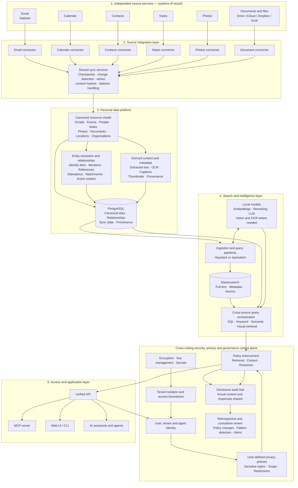

# Rosalind — Personal Data Platform

## Vision and target architecture

**Status:** Project vision and architectural direction  
**Deployment ambition:** Cloud-capable by design; local development and self-hosted deployment are supported profiles, not architectural assumptions  
**Primary principle:** Each source application remains the owner of its data; Rosalind makes that data consistently accessible, searchable and useful across services, under explicit privacy, security and disclosure controls.

---

## 1. The vision

Rosalind is a personal data platform that connects independently managed personal information services and makes their data accessible through one unified interface. It should support local, self-hosted and managed-cloud deployments without changing its core data and governance model.

The goal is not to replace email, calendar, contacts, notes, photo or file-management applications. Each service continues to own and manage its own data, using its own storage model and application-specific features.

Rosalind connects to those services, reads and synchronises their data, creates a consistent representation of the information, resolves relationships between resources, and exposes the resulting personal information through search, APIs and AI assistants.

A person should be able to ask a question that spans several applications and receive an answer grounded in the underlying records. For example:

- Find the email where a colleague suggested a restaurant, identify the related trip in my calendar, and show the photos taken there.
- Summarise everything I have about a project across email conversations, notes, meetings and documents.
- Find the latest version of a document discussed in an email and identify the people involved.
- Show the meetings I had with a particular person, the notes associated with those meetings and the documents exchanged afterwards.
- Find photographs from a particular event using its date, location, attendees or related correspondence.

This is broader than an email RAG application. It is a **personal data integration and retrieval platform**, with RAG as one of several ways to access and use the data.

## 2. Architectural principles

### 2.1 Source applications remain authoritative

Every connected application remains the system of record for the data it owns. Rosalind is a read-only consumer of those systems.

For example:

- Stalwart remains authoritative for email and mailbox state.
- The calendar service remains authoritative for events and invitations.
- The contacts service remains authoritative for address-book records.
- The notes service remains authoritative for notes and their organisation.
- The photo service remains authoritative for original photographs, albums and photo-library state.
- The document service remains authoritative for original files, folders, sharing and file versions.

Rosalind stores derived and synchronised representations to support integration and retrieval. It must not silently become a second system of record.

### 2.2 Independent services, common access

Sources can use different APIs, protocols, data models and storage technologies. The platform should hide those differences behind source-specific connectors and a common internal resource model.

A new source should be addable without redesigning the entire platform or changing existing connectors.

### 2.3 Preserve provenance

Every synchronised resource and every derived representation must remain traceable to its original source. Search results and AI answers should identify the source application and link or reference the original record whenever possible.

### 2.4 Separate integration from intelligence

Data synchronisation, normalisation and relationship management must work independently of any LLM or RAG framework. Search, RAG, agents, dashboards and other applications should consume the same platform capabilities.

### 2.5 Deployment-independent privacy by design

Local execution is a useful development and self-hosting profile, but it is not the security model. The target architecture must also support a cloud deployment that protects personal data against external attackers, cross-tenant exposure, compromised credentials, malicious integrations, excessive internal access and unintended disclosure to AI agents or model providers. Privacy and security controls must be part of the platform architecture and remain consistent across local, self-hosted and managed-cloud deployments.

The deployment model may change where data is processed and who operates the infrastructure, but it must not weaken the user-facing privacy guarantees. Any transfer to an external source, model provider, subprocessor or agent must be explicit, governed and auditable.

### 2.6 Read-only source access

Connectors should use source credentials and permissions limited to reading and synchronising data. They must not send messages, modify events, edit notes, change contacts, delete files or alter photo libraries.

Read-only access should be enforced by the source service's permissions where possible, not merely by application convention.

### 2.7 Agent-scoped privacy and information filtering

The owner must be able to decide which parts of their personal information may be made available to each connected agent or client. These controls must apply across all connected sources, not just within an individual application or search index.

A user should be able to express a policy in terms of a sensitive topic, person, source, purpose or agent. For example: **"Agent A must not learn that I have cancer."** Rosalind should interpret this as a restriction on relevant information across emails, contacts, calendar events, notes, documents, photographs and any other connected source—not merely as a rule that hides records containing the word "cancer".

Filtering must consider both direct disclosure and information that could reasonably contribute to a sensitive inference. A doctor's email, a medical document, a photograph from treatment, a family message, or a sequence of apparently unrelated absences and personal messages may each reveal or help infer the same sensitive fact.

The policy boundary must therefore cover retrieval, context construction and the response returned to the agent. Removing an explicitly sensitive document from search results is not sufficient if other records can reconstruct the same information. Policies should be understandable, reviewable and specific to the agent or sharing context to which they apply.

### 2.8 Disclosure auditing and retrospective review

Rosalind must maintain an audit record of information actually disclosed to each agent, not just the records that were searched or considered. The audit should make it possible to establish who received what information, when, in response to which request, and under which privacy policy.

Auditing is necessary because perfect filtering cannot be assumed. A single disclosure may violate a policy, and several individually innocuous disclosures may collectively reveal something sensitive. The platform should therefore support both event-level auditing and review of disclosure patterns over time.

When a user creates or tightens a policy, Rosalind should be able to examine relevant prior disclosures and alert the user to potential conflicts. For example, a newly created health-related restriction could reveal that a medical document had already been shared with an agent the previous day. Ongoing review should also look for cumulative patterns—for example, repeated work absences, family check-ins and a message about hair loss—that may together expose a sensitive health situation.

Audit records and alerts are themselves sensitive personal data. They must be protected, access-controlled and retained according to an explicit policy. Pattern detection should be presented as a risk signal for user review, not as a guarantee that every possible inference or breach can be detected.

---

## 3. Connected source services

The platform should support distinct services, each with its own storage and lifecycle.

| Domain | Example service | Typical data | Important characteristics |
|---|---|---|---|
| Email | Stalwart; potentially other mail providers | Messages, threads, mailboxes, headers, attachments | Conversation structure, MIME content, sender/recipient identities, timestamps |
| Calendar | CalDAV-compatible or provider calendar service | Events, calendars, attendees, recurrence, locations | Strong temporal structure, time zones, recurring events and participant relationships |
| Contacts | CardDAV-compatible or provider address book | People, organisations, email addresses, phone numbers, postal addresses, notes | Multiple identifiers for the same person; duplicate and identity resolution concerns |
| Notes | Apple Notes-, Google Keep- or similar service | Notes, rich text, checklists, tags, folders, embedded media | Hierarchical or semi-structured text, links and attachments |
| Photos | Apple Photos-, Google Photos- or similar service | Original images, albums, timestamps, locations, metadata | Large binary objects, EXIF metadata, visual content and multimodal search |
| Documents and files | Google Drive, iCloud Drive, Dropbox or local files | Documents, spreadsheets, PDFs, presentations, folders and versions | File hierarchy, revisions, sharing permissions, content extraction and duplicate files |

The list is intentionally extensible. Other sources—tasks, bookmarks, messages, health records or personal finance data, for example—could be added later, subject to privacy, security, access and integration requirements.

### 3.1 Contacts are a first-class source

Contacts should not be treated only as metadata embedded in emails or calendar events. A contacts service is an independent source of address-book records and should have its own connector and synchronisation state.

The platform should preserve the original contact record while also maintaining a canonical person entity. A person may have several email addresses, phone numbers, names, organisations and source-specific IDs.

Identity resolution should be conservative. Rosalind may propose that two records refer to the same person, but it should preserve the original records and the evidence or confidence behind any match. Ambiguous matches must not be silently merged.

### 3.2 Documents and files are a first-class source

A document service covers files stored outside email attachments: documents in Drive, iCloud Drive or Dropbox, as well as potentially local folders.

The platform should preserve file identity, folder context, MIME type, size, timestamps, version information and source permissions. Extracted text and other derived representations can be indexed, but the original file remains in its source service.

Email attachments and cloud-drive files can share a common document representation for retrieval, while retaining their distinct origins and relationships. An attachment is not automatically the same resource as a similarly named Drive file; duplicate detection and matching should be explicit and reversible.

### 3.3 Photos require a multimodal path

Photo ingestion is not simply another text-document pipeline. In addition to source metadata, Rosalind may derive thumbnails, OCR text, captions and visual embeddings using local models.

Original images remain in the photo service. Derived descriptions and embeddings are searchable representations, not replacements for the image itself.

---

## 4. Target architecture

The logical architecture is organised into five layers.



The diagram describes logical responsibilities, not a requirement to deploy every component as a separate process. The initial implementation should remain a modular monolith with a small number of deployable services.

### Layer 1 — Independent source services

These are the applications that own the original data. They can be self-hosted or external services, provided a suitable local or remote read-only integration is available.

### Layer 2 — Source integration

Each source has a dedicated connector that understands its API, protocol, identifiers, pagination, rate limits and change semantics.

Connectors should share a small set of operational capabilities:

- Initial full synchronisation.
- Incremental synchronisation.
- Checkpoint and cursor persistence.
- Idempotent processing and content hashing.
- Update and deletion detection.
- Retry handling and error reporting.
- Source ID and revision preservation.
- Read-only access enforcement.

The connector is responsible for extracting source data and translating it into the platform's canonical representation. It should not implement RAG logic.

### Layer 3 — Personal data platform

This is the durable integration core. It maintains canonical resources, source provenance, synchronisation state and relationships across applications.

PostgreSQL is the initial candidate for canonical structured storage. It should retain the source identity of every record and support relationships between resources from different services.

The platform may store extracted text and selected derived artifacts. It should not automatically duplicate all original files and media. Large originals should remain in their authoritative source services; local caching should be deliberate and governed by a retention policy.

### Layer 4 — Search and intelligence

This layer creates indexes and answers queries over the personal data platform.

A candidate stack is:

- Elasticsearch for full-text search, structured filters, aggregations and vector retrieval.
- Haystack for explicit ingestion and query pipelines.
- Local embedding, reranking and language models, initially through Ollama or another suitable local runtime.
- A dedicated multimodal processing path for photos and other non-text resources.

The search indexes are derived and rebuildable. They are not the authoritative store.

### Layer 5 — Access and applications

The platform exposes stable capabilities through an API. Other interfaces should reuse this API rather than connect directly to source services or search indexes.

Potential clients include:

- A web-based personal information assistant.
- A command-line interface.
- An MCP server for compatible AI clients.
- Other local applications, dashboards and agents.

The initial interface can be simple. The underlying data, security and access contracts are the more important long-term assets.

### Cross-cutting layer — Governance, privacy and security

Governance and security are not optional stages that can be bypassed by a particular connector or retrieval method. They form a control plane across identity, source integration, storage, indexing, inference and access. Every request must have a verified user, tenant, agent identity and sharing context; every data access and disclosure must be authorised under the applicable policies; and sensitive operations must be auditable.

The control plane has three related responsibilities:

1. **Policy definition:** let the owner define what each agent may and may not learn, including restrictions based on sensitive topics and information that could support an inference about those topics.
2. **Policy enforcement:** apply restrictions before information is retrieved for an agent, while evidence is assembled into model context, and before an answer is returned. This must cover direct source records, derived content, summaries and cross-source combinations.
3. **Disclosure auditing:** record the evidence and information actually made available to the agent, the policy applied and the response delivered. Use this history for retrospective checks, cumulative-risk detection and user alerts.

A policy such as "Agent A must not learn that I have cancer" is an end-to-end information-sharing constraint. It should cover medical records, correspondence with doctors or family, treatment-related photographs, calendar patterns, work absences and other contextual clues that could reveal or support the same inference. The user should not have to identify every individual record in advance.

Rosalind should aim to minimise the possibility of both direct and indirect disclosure, but it must not promise perfect prevention. Information can be ambiguous, context-dependent and cumulative; a model or recipient may infer sensitive facts from combinations that are not individually obvious. The product should make this limitation explicit and combine policy enforcement with comprehensive disclosure records and ongoing risk review.

---

## 5. Canonical resource model and relationships

A common resource model allows different services to be queried consistently without pretending that all source data has the same shape.

Initial resource types should include:

- `Person` and `Organisation`
- `Email` and `EmailThread`
- `CalendarEvent` and `Calendar`
- `Contact`
- `Note`
- `Photo` and `Album`
- `Document` and `Folder`
- `Location`

A resource should have a stable internal ID and retain its source identity. A conceptual common envelope is:

```python
class Resource:
    id: UUID
    resource_type: str
    source: str
    source_id: str
    source_revision: str | None
    created_at: datetime | None
    updated_at: datetime | None
    content_hash: str | None
    metadata: dict
```

This is a conceptual contract, not a requirement that every resource be stored in one generic table. Typed relational tables can preserve domain-specific structure while sharing common identity and provenance conventions.

Relationships connect records across services. Examples include:

```text
Email #123       --sent_by----------> Person #42
Email #123       --mentions---------> Person #77
Email #123       --has_attachment---> Document #900
Event #81        --has_attendee-----> Person #42
Event #81        --held_at----------> Location #9
Note #789        --mentions---------> Person #42
Photo #456       --taken_at---------> Event #81
Photo #456       --located_at-------> Location #9
Document #900    --stored_in-------> Folder #12
```

Relationships should retain their provenance: which source record or processing step established the link, and whether the link is explicit or inferred.

Start with relational tables in PostgreSQL. A dedicated graph database is not a prerequisite. Introduce one only if real traversal or graph-analytics requirements justify the added operational complexity.

---

## 6. Retrieval is not limited to RAG

The platform should support several retrieval modes because different questions require different techniques.

| Retrieval mode | Best suited to |
|---|---|
| Structured queries | Counts, date ranges, participants, event times, file types and exact attributes |
| Full-text search | Names, phrases, identifiers, filenames and exact terms |
| Semantic retrieval | Conceptual questions over emails, notes and documents |
| Visual retrieval | Image similarity and natural-language search over photo content |
| Relationship traversal | Connecting people, meetings, messages, notes, places and files |

The query layer should select and combine these mechanisms. It should not send every question directly to vector search.

For example, “How many meetings did I have with Alex last month?” is a structured calendar query. “What did Alex and I discuss about the product launch?” may require email, notes and calendar retrieval followed by synthesis. “Find photographs from that launch” adds visual and temporal retrieval.

RAG is one response pattern: retrieve relevant evidence, construct context and ask a model to synthesise an answer. It is not the storage model, the integration architecture or the only way to access the data.

---

## 7. Data processing by resource type

The platform should standardise connector contracts while allowing specialised processing pipelines.

| Resource | Processing and derived representations |
|---|---|
| Email | MIME parsing, HTML normalisation, headers, thread relationships, attachment extraction, text chunks and embeddings |
| Calendar event | Structured normalisation, timezone handling, recurrence, attendee resolution, location and description indexing |
| Contact | Name and address normalisation, identity matching, source-specific identifiers and relationship linking |
| Note | Rich-text conversion, heading and list preservation, tags, links, chunking and embeddings |
| Document | Format detection, text/table extraction, page or section structure, version metadata, chunking and embeddings |
| Photo | EXIF extraction, thumbnails, OCR, local captioning and compatible visual/text-image embeddings |

Processing should be repeatable and versioned. If a parser, chunking strategy or embedding model changes, derived representations should be rebuildable without changing the source records.

Different embedding models may be appropriate for different modalities. Vectors from incompatible embedding spaces must not be compared as though they were equivalent.

---

## 8. Synchronisation, lifecycle and consistency

The platform is a synchronised representation of source data, not a live transactional replica.

Each connector should define how it detects and handles:

- New resources.
- Modified resources.
- Deleted resources.
- Moves or changes in parent containers, such as mailbox, calendar, folder or album.
- Permission changes or loss of access.
- Source revisions and duplicate records.
- Temporary source unavailability and partial failures.

Synchronisation state belongs to the integration layer. A failed run should be resumable, and reprocessing the same source revision should not create duplicate canonical resources or search documents.

Deletion handling deserves particular care. When a source record is deleted or becomes inaccessible, Rosalind should remove or appropriately tombstone its derived representations according to the configured policy. It should not leave stale content searchable indefinitely.

Search indexes should be rebuildable from canonical data and derived content. The platform should track the versions of parsers, extraction logic, chunking strategies and embedding models used to create each index.

---

## 9. Data privacy, security and trust

Privacy and security are foundational product requirements, not deployment options and not features that can be delegated entirely to the privacy-filtering engine. Rosalind will hold a highly concentrated representation of a person's life across email, contacts, calendar, notes, documents and photographs. A cloud version must therefore be designed on the assumption that the platform is an attractive target and that a single access-control failure could expose information from several parts of a person's life.

The goal is not to claim that risk can be eliminated. The goal is to minimise the data collected and exposed, enforce clear trust boundaries, make access decisions consistently, detect and contain failures, and give the user credible evidence about how their information has been used.

### 9.1 Threat model and security objectives

The architecture should explicitly account for at least these risks:

- An external attacker compromises an account, API, connector, application or cloud workload.
- One customer or tenant gains access to another customer's data through an indexing, query, cache, storage or authorization defect.
- A compromised agent, leaked token or over-permissioned integration accesses more information than intended.
- A malicious or compromised source document contains prompt-injection instructions or content intended to manipulate an AI model.
- An employee, operator, support process or subprocessor accesses personal data without a legitimate need.
- Data is exposed through logs, traces, analytics, crash reports, backups, exports or model-provider requests.
- A deletion, policy change or source-permission change is not propagated to derived data and indexes.
- A privacy policy fails to prevent an indirect or cumulative inference, or the audit system fails to detect it.

The core security objectives are confidentiality, integrity, availability, tenant isolation, least privilege, accountability and user control. These objectives apply to original data, canonical records, extracted text, embeddings, derived media, search indexes, prompts, model context, outputs, audit records and backups.

### 9.2 Data minimisation and lifecycle control

Rosalind should collect and retain only what is needed for the features the user has enabled. The platform should distinguish source data from derived representations and make the lifecycle of each explicit.

- Keep original records in their authoritative source whenever practical; avoid copying all original binaries into Rosalind by default.
- Make caching, full-content replication, OCR, captioning and other derived processing explicit product choices with clear purposes.
- Retain source identifiers, revisions and provenance so that derived records can be updated or removed when the source changes.
- Propagate source deletion, revoked permissions and user deletion requests to canonical data, extracted content, indexes, embeddings, caches and downstream copies, subject to clearly disclosed backup-retention windows.
- Provide understandable retention controls for synchronised data, derived data, audit evidence and backups.
- Do not use customer personal data to train shared models or improve services by default. Any exceptional use would require a separate, explicit and informed choice and an appropriate legal basis.

Data minimisation is a security measure as well as a privacy principle: information that is never collected or retained cannot be exposed by a later breach.

### 9.3 Identity, authentication and authorization

Rosalind must distinguish the human account owner, the tenant or personal workspace, connected source accounts, applications, service identities and individual AI agents. An agent is a distinct security principal, not merely a label supplied in a prompt.

Access should follow least privilege and default-deny principles:

- Strong user authentication, with multi-factor authentication for cloud accounts and privileged actions.
- Short-lived, revocable credentials and narrowly scoped tokens for agents and integrations.
- Separate credentials and permissions for each connected source and background service.
- Explicit consent and clear scopes when connecting a source or granting an agent access.
- Immediate revocation when a token, integration, agent or user session is disabled.
- Authorization checks on every request and every resource, not only at login or at the user-interface boundary.
- Separate administrative access from customer data access, with privileged access restricted, justified and audited.

The platform should follow a zero-trust approach: being inside the cloud network, authenticated to the application or previously authorised does not automatically grant access to a resource. Authorization must be evaluated using the identity, tenant, resource, action, purpose and applicable privacy policy for each request.

### 9.4 Tenant isolation for the cloud service

A managed-cloud version must provide strong isolation between customers. Authentication alone is not tenant isolation. Tenant boundaries must hold consistently across every place where customer data or derived data can exist:

- Canonical databases and relational records.
- Object storage and cached source files.
- Search indexes, vector representations and retrieval results.
- Queues, background jobs and temporary processing areas.
- Model context, conversation history and agent sessions.
- Logs, traces, analytics and support tooling.
- Audit records, exports, snapshots and backups.

The architecture should make tenant context explicit and enforce it centrally and at relevant storage boundaries, rather than relying on developers to remember to add a tenant filter to every query. Isolation strength should be selectable according to risk and product tier: shared infrastructure can be appropriate when isolation is enforced and tested rigorously, while dedicated databases, indexes, encryption keys or deployment environments may be offered where stronger separation is required.

A cross-tenant access failure should be treated as a critical security incident. Tenant isolation must be tested continuously, including negative tests that attempt to access another tenant's resources by changing identifiers, filters, index names or job parameters.

### 9.5 Encryption, key management and secrets

All network communication should use modern TLS. Stored data should be encrypted at rest, including databases, object storage, search indexes, queues, snapshots and backups. Encryption keys and application secrets must be managed separately from the data they protect, with controlled access, rotation, revocation and auditable administrative operations.

The architecture should support envelope encryption and per-tenant key separation as a baseline direction, with customer-managed keys or stronger isolation options considered for higher-assurance deployments.

An important product distinction must remain explicit: encryption at rest and in transit does not mean that Rosalind's cloud application operator is cryptographically unable to read customer data. If the service performs server-side parsing, indexing, retrieval or LLM inference, the relevant processing components must access plaintext at some point. True end-to-end encryption, where the service operator cannot access plaintext, is a different architecture and generally requires processing and key control on the user's device or another trusted execution boundary. Rosalind must describe its actual confidentiality model accurately and must not market ordinary server-side encryption as end-to-end encryption.

Secrets such as source refresh tokens, API keys, signing keys and database credentials must never be embedded in code, images, source documents or logs. They should be stored in a dedicated secrets-management system and exposed only to the workload that needs them.

### 9.6 Privacy policies and agent-scoped information control

The owner must be able to decide what each agent may access or infer across all connected sources. Policies should be scoped to a specific agent or sharing context and may concern sensitive topics, people, sources, resource types, purposes or combinations of information.

A policy such as **"Agent A must not learn that I have cancer"** is not equivalent to hiding documents containing the word "cancer". It is an information-sharing constraint across medical records, correspondence, calendar patterns, work absences, family messages, photographs and other contextual clues that could reveal or support the inference.

Policy enforcement should cover the complete disclosure path:

1. Before retrieval, constrain which resources and derived representations may be considered.
2. During retrieval and context construction, assess the combined evidence and remove or minimise material that violates the policy.
3. Before an answer is returned, check that the response does not disclose restricted information or a prohibited inference.
4. Before any external tool, model provider or agent receives data, apply the relevant sharing and transfer policy.

If policy evaluation is uncertain or unavailable, the safe behaviour should be to withhold the potentially restricted information or ask the user for clarification, rather than silently allow disclosure. Policies, policy changes and enforcement outcomes should be understandable and reviewable by the owner.

The product must be honest about the limits: no system can guarantee that an agent will never infer a sensitive fact from permitted information, prior knowledge or information obtained elsewhere. Rosalind should reduce foreseeable disclosure, minimise the information shared, apply conservative controls and make residual risk visible.

### 9.7 Disclosure auditing and breach detection

Rosalind should maintain a disclosure ledger for information made available to agents and external processing services. It should record more than a list of retrieved document IDs. The record should make it possible to reconstruct what information crossed a trust boundary, for which request, to which recipient, under which identity and policy, and what response was returned.

The audit model should distinguish:

- Data considered or retrieved internally.
- Data supplied to an internal model or processing component.
- Data sent to an external model provider or subprocessor.
- Data returned to an agent or client.
- Data denied, filtered or withheld by policy.

Audit evidence is itself sensitive. The system should avoid turning ordinary application logs into a second ungoverned copy of personal data. A suitable product direction is to keep a minimal, tamper-evident event record containing identities, timestamps, policy decisions, source references, resource versions and cryptographic hashes, with any exact disclosure snapshot stored separately in a strongly protected, encrypted evidence store where justified. Access to audit evidence should be restricted and itself audited. Retention and deletion rules must be explicit.

The platform should support:

- User-visible history of what each agent was given.
- Retrospective review when a policy is created or tightened.
- Detection of disclosures that conflict with current policies.
- Analysis of cumulative disclosures that may reveal sensitive information when combined.
- Alerts for suspicious access patterns, unexpected volume or unusual recipients.
- Incident investigation, evidence preservation and user notification.

Risk detection is not proof that an agent has inferred a fact, and the absence of an alert is not proof that no disclosure occurred. The interface should distinguish confirmed policy violations, suspicious patterns and uncertain inferences.

### 9.8 AI-specific security

Emails, notes, documents, calendar descriptions, contact fields, images and OCR output are untrusted data. They may contain malicious instructions, hidden text or content designed to manipulate an AI model.

Retrieved content must never be treated as system instructions or granted authority to change policies, call tools, access other resources or override the user's permissions. Tool execution should be separately authorised, narrowly scoped and subject to the same identity, tenant and privacy checks as ordinary retrieval.

The platform should minimise the context sent to models, separate instructions from retrieved evidence, validate structured model outputs and apply policy checks to both tool results and generated answers. Model-provider selection, retention behaviour, training terms, region and subprocessors should be treated as security and privacy decisions, not merely model-quality choices.

### 9.9 Cloud operations and secure engineering

Cloud security is an ongoing operational responsibility, not a one-time architecture task. The target operating model should include:

- Infrastructure as code, hardened deployment configurations and network segmentation.
- Separate development, test and production environments, with synthetic or appropriately sanitised test data.
- Secure software development, dependency and container scanning, patch management and vulnerability disclosure handling.
- Independent security reviews and penetration tests, especially for tenant isolation, authorization and agent disclosure paths.
- Central security monitoring with privacy-conscious logs that avoid unnecessary personal content.
- Encrypted backups, tested restoration and documented disaster-recovery objectives.
- Incident response procedures for credential compromise, data exposure, cross-tenant access and subprocessor incidents.
- Restricted, time-limited and audited support access; customer content should not be routinely visible to support personnel.
- A documented inventory of data flows, subprocessors, processing regions and retention periods.

Security controls should be continuously tested. The development process should follow an established secure software development framework, and API design should be reviewed against recognised API security risks such as broken object-level authorization, broken authentication and excessive data exposure.

### 9.10 Legal and regulatory readiness

For a cloud service handling personal information, privacy engineering must be accompanied by a clear legal and operational model. The project should be designed with GDPR requirements in mind, including data protection by design and by default, security of processing, transparency, purpose limitation, data minimisation, retention, user rights and appropriate processor/controller arrangements.

Health data and other special-category information require particular care under GDPR Article 9. The product should not assume that the user's ownership of a data source automatically resolves the legal basis or conditions for every processing activity. Before a public cloud launch, the company should assess its roles for each processing purpose, lawful bases and applicable Article 9 conditions, data-processing agreements, international transfers, subprocessor arrangements and whether a Data Protection Impact Assessment is required. This section is an architectural direction, not legal advice or a claim of compliance.

### 9.11 Deployment profiles and honest privacy claims

The same privacy and security principles should apply to every deployment profile:

- **Local/self-hosted:** the user operates the environment and controls local infrastructure, while still needing secure credentials, access control, backups and device protection.
- **Managed cloud:** Rosalind operates the service and is responsible for strong tenant isolation, cloud security, operational controls, data lifecycle management and transparent subprocessor arrangements.
- **Dedicated or customer-controlled deployment:** an option for users requiring stronger infrastructure isolation, customer-managed keys or control over processing location.

These profiles may differ in who can access infrastructure and where keys are held, but the product must clearly explain those differences. Local-first is a useful deployment option, not a substitute for a cloud security architecture.

## 10. Candidate technology direction

The following is a pragmatic starting point, not a permanent commitment. Interfaces should make it possible to replace individual components.

| Concern | Initial candidate | Rationale |
|---|---|---|
| Connectors and application logic | Python | Broad ecosystem for APIs, parsing and local processing |
| API | FastAPI | Thin, typed application boundary |
| Canonical structured data | PostgreSQL | Relational data, source identity, sync state and relationships |
| Search and indexing | Elasticsearch | Full-text search, filtering, aggregations and vector retrieval |
| RAG pipeline framework | Haystack | Explicit, testable ingestion and query pipelines |
| Model runtime | Ollama or equivalent local/private model serving | LLM and embedding inference under the selected deployment and data-residency policy |
| Migrations | Alembic | Versioned PostgreSQL schema changes |
| Deployment | Docker Compose initially; cloud orchestration when justified | Supports local development without constraining the cloud target |
| Interfaces | API, MCP, CLI and web UI | Multiple clients over shared capabilities |

LlamaIndex remains a valid alternative to Haystack, particularly if the project becomes dominated by heterogeneous document ingestion. The project should select one primary pipeline framework rather than combine multiple orchestration frameworks without a clear need.

Elasticsearch is a candidate search engine, not the canonical data store. If its local resource cost is too high on the target Mac, PostgreSQL Full-Text Search and pgvector are a viable simpler starting point. Retrieval quality and memory consumption should be measured before committing to either option.

### Initial development environment

The first implementation may run on a MacBook Pro M2 with 16 GB unified memory. This is a development and validation environment, not a constraint on the target cloud architecture. The codebase should favour a modular monolith and a small number of deployable components initially, while keeping clear boundaries around connectors, data access, retrieval, policy enforcement and audit.

Avoid introducing Kubernetes, distributed processing, a dedicated graph database or multiple overlapping search systems before they are justified. The logical architecture should be cloud-capable without requiring a distributed physical architecture during early development.

---

## 11. Delivery roadmap

The roadmap should validate the platform incrementally while keeping the long-term resource model in view.

### Phase 1 — Platform foundation and email

- Define an initial threat model, trust boundaries and security baseline before ingesting real personal data.
- Establish user, tenant, service and agent identity concepts, even if the first deployment has only one user.
- Set up secrets management, encrypted storage, access-controlled environments and privacy-conscious logging.
- Define the connector contract and canonical resource envelope.
- Implement the read-only Stalwart/JMAP connector.
- Synchronise mailboxes, messages, threads and attachments.
- Introduce PostgreSQL for canonical data, provenance and sync state.
- Extract and normalise email and attachment content.
- Add search indexing and a first retrieval workflow.
- Validate completeness, incremental updates and deletion handling.

### Phase 2 — Contacts and calendar

- Add an independent contacts connector.
- Add calendar synchronisation and temporal normalisation.
- Introduce canonical people, organisations, events and locations.
- Link senders, recipients and attendees to people conservatively.
- Support structured questions alongside semantic retrieval.

### Phase 3 — Notes and document storage

- Add a notes connector.
- Add one document-storage connector, selected according to available local/API access.
- Preserve folders, versions, tags and source permissions.
- Extract text from common document formats.
- Link attachments and cloud-drive files without incorrectly treating matching filenames as identical documents.

### Phase 4 — Photos and multimodal retrieval

- Add a photo-library connector.
- Extract EXIF metadata and location information.
- Add local OCR and image captioning where useful.
- Evaluate visual embedding models compatible with the local hardware.
- Support text-to-image and image-similarity retrieval.

### Phase 5 — Cross-source intelligence

- Improve person, organisation, event and location resolution.
- Build relationship-aware retrieval and query planning.
- Combine structured, lexical, semantic and visual evidence.
- Provide source-grounded answers with references to original records.
- Expose the platform through MCP and other clients.
- Benchmark ingestion, retrieval and end-to-end answer quality across sources.

### Phase 6 — Cloud security and launch readiness

- Select the cloud deployment and tenant-isolation model.
- Validate isolation across databases, object storage, search indexes, queues, caches, model context, audit records and backups.
- Complete independent security reviews and penetration testing of authorization, tenant boundaries and agent disclosure paths.
- Establish incident response, vulnerability management, backup restoration and operational monitoring.
- Complete privacy documentation, subprocessor and data-transfer reviews, retention rules and any required impact assessment before handling customer data in a managed cloud service.
- Publish accurate descriptions of encryption, operator access, model processing, data residency and the limits of inference filtering.

---

## 12. What success looks like

The platform should eventually make it possible to:

- Search all connected personal information from one place.
- Ask questions spanning multiple independent applications.
- Navigate from an answer back to the original email, event, contact, note, photograph or file.
- Search exact metadata and dates as reliably as conceptual text.
- Find visual information in photographs using natural language.
- Identify relationships between people, events, messages, notes and documents.
- Add a new source through a connector without redesigning the core platform.
- Change the RAG framework, search engine or local model without changing the source systems or canonical integration contracts.
- Rebuild derived indexes from synchronised data.
- Make processing location and external data transfers explicit, user-controlled and auditable across local, self-hosted and cloud deployments.
- Let the owner define agent-specific restrictions over sensitive information across all connected sources.
- Reduce direct and indirect disclosure, including inferences supported by combinations of records.
- Maintain an auditable record of the information actually shared with each agent.
- Review historical and cumulative disclosures when policies change or potential inference risks emerge.

The defining characteristic of Rosalind is not a particular LLM, vector database or RAG framework. It is the ability to integrate independently managed personal data while preserving source ownership, provenance, security and privacy—and to make that information useful across application boundaries under policies controlled by the owner.

**The long-term objective is a unified, privacy-preserving interface to a person's digital life, built on top of independent services rather than replacing them, and deployable locally, self-hosted or in a secure cloud environment.**


---

## 13. Security and privacy reference frameworks

The following are reference points for future design reviews. They are not certifications or evidence that Rosalind is compliant by default.

- [NIST SP 800-207 — Zero Trust Architecture](https://csrc.nist.gov/pubs/sp/800/207/final): identity- and context-aware access decisions, policy decision and enforcement concepts.
- [OWASP API Security Top 10](https://owasp.org/www-project-api-security/): API-specific risks including broken object-level authorization, authentication failures and excessive data exposure.
- [OWASP Cloud Tenant Isolation](https://owasp.org/www-project-cloud-tenant-isolation/): risks and mitigations for cross-tenant access in cloud services.
- [NIST SP 800-218 — Secure Software Development Framework](https://csrc.nist.gov/pubs/sp/800/218/final): security practices integrated throughout the software development lifecycle.
- [GDPR — Regulation (EU) 2016/679](https://eur-lex.europa.eu/eli/reg/2016/679/oj/eng/): in particular Articles 5, 9, 25, 28, 32 and, where applicable, 35, covering principles, special-category data, data protection by design, processor arrangements, security and impact assessments.
- [AWS SaaS Architecture Fundamentals — Tenant Isolation](https://docs.aws.amazon.com/whitepapers/latest/saas-architecture-fundamentals/tenant-isolation.html): an implementation-oriented explanation of tenant isolation as a distinct requirement from authentication and general authorization.
